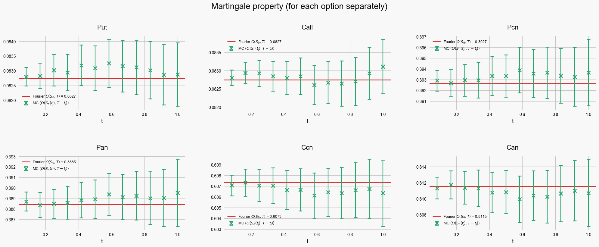
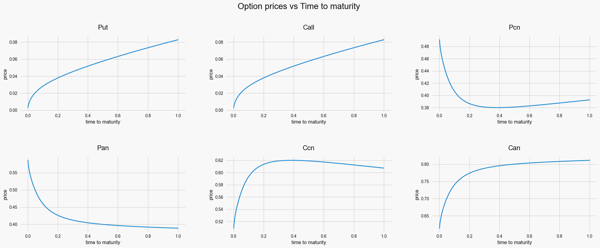

# Heston Model: Fourier (SINC) Pricing and Monte Carlo Simulation

Pricing of European and digital options under the Heston stochastic volatility model with a Fourier/SINC method, cross-checked against Monte Carlo simulation using exact CIR variance sampling and Andersen's Quadratic-Exponential (QE) scheme.

Project for the Computational Finance course, M.Sc. in Quantitative Finance, University of Bologna.

## What it does

**Fourier pricer**
- Characteristic function of the log-price derived from the affine (complex CIR) structure of the model.
- SINC (Fourier-sine) series for the probabilities P(X_T < w) under both the risk-neutral and the asset measure. The series is truncated adaptively once the relative term size drops below 1e-8.
- Prices six contracts: put, call, cash-or-nothing put/call (Pcn, Ccn) and asset-or-nothing put/call (Pan, Can). The pricer is vectorized over 100,000 simulated (S, ν) states, so a whole cross-section of paths is priced in one call.

**Monte Carlo**
- The variance is sampled exactly from its noncentral chi-squared transition. The log-price is updated conditionally on the variance path, with integrated variance approximated by the trapezoidal rule.
- Andersen's QE scheme for the variance with the matching log-price discretization (Andersen, eq. 33).
- Antithetic variates for both schemes.
- A truncated Euler benchmark (negative variances floored at zero) showing the discretization bias that motivates the exact and QE schemes.

**Validation checks**
- Martingale property of S_t and of every option price along simulated paths: the MC mean of O(S(t_j), T − t_j) is checked against the t = 0 Fourier price at each month, with ±2σ bands.
- Empirical spot–variance correlation compared with ρ.
- Model-free identities: put–call parity, Pcn + Ccn = 1, Pan + Can = S₀. The call is also rebuilt both from parity and from digitals. The two estimators give identical means and standard errors, because the Fourier prices satisfy parity exactly on every path.

## Results

Parameters: λ = 1.0318, ν̄ = 0.0782, η = 1.0, ν₀ = 0.04, ρ = −0.6451, S₀ = K = 1.2, T = 1, r = 0. Simulation: 100,000 paths, 252 steps.

Fourier prices at t = 0:

| Put | Call | Pcn | Pan | Ccn | Can |
|---|---|---|---|---|---|
| 0.082747 | 0.082747 | 0.392665 | 0.388450 | 0.607335 | 0.811550 |

- **Martingale check:** MC put prices stay within ±1.3σ of the Fourier price at every monthly date, and E[S_t] stays within ±2σ of S₀.
- **Correlation:** empirical −0.6446 ± 0.0006 against a theoretical −0.6451.
- **Exact CIR vs QE:** the two put estimates differ by 3.6e-5, against a standard error of about 5e-4.
- **Antithetic variates:** they reduce the standard error by about 1.25× for both schemes.
- **Euler bias:** with 252 steps, E[S_T] = 1.1799 ± 0.0016 against S₀ = 1.2. The bias shrinks slowly and is still visible at 2,000 steps (1.1876). The exact-variance scheme shows no detectable bias at 252 steps (1.2002 ± 0.0015).





## Running it

```bash
pip install -r requirements.txt
jupyter notebook heston.ipynb
```

The full run uses 100,000 paths and needs about 8 GB of RAM. Most of that goes to the Euler bias test at 2,000 steps. On a smaller machine, set `N_traj = 10000` in the parameters cell. The notebook runs end to end in under a minute that way, with wider error bands. Seeds are fixed, so a full run reproduces the numbers above.

## References

- Heston, S. L. (1993). A closed-form solution for options with stochastic volatility with applications to bond and currency options. *Review of Financial Studies*, 6(2).
- Broadie, M., & Kaya, Ö. (2006). Exact simulation of stochastic volatility and other affine jump diffusion processes. *Operations Research*, 54(2).
- Andersen, L. (2008). Simple and efficient simulation of the Heston stochastic volatility model. *Journal of Computational Finance*, 11(3).
- Baschetti, F., Bormetti, G., Romagnoli, S., & Rossi, P. (2022). The SINC way: a fast and accurate approach to Fourier pricing. *Quantitative Finance*, 22(3).

## License

MIT
